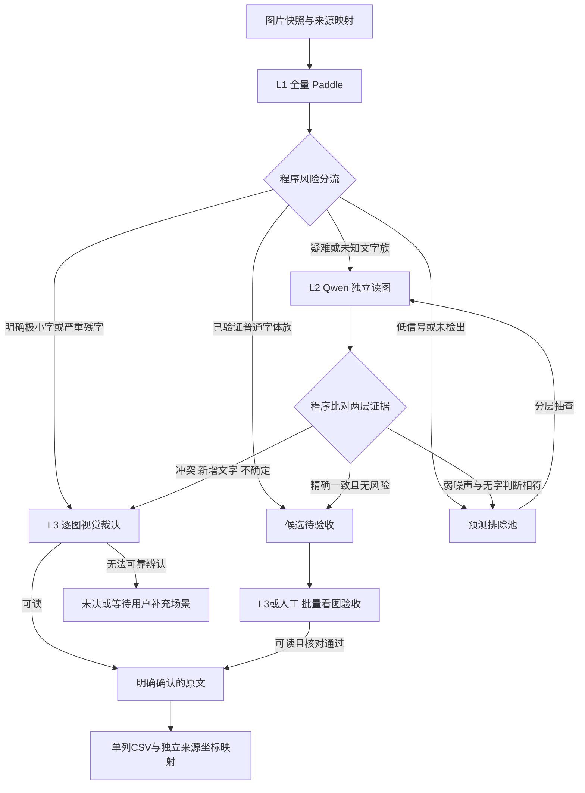

# 图片文字提取三级工作流 v1

状态：**v0.5基础闭环已实现**。新入口 `image_workflow.py` 已接入风险路由、选择性Qwen、对话Agent任务包/视觉确认导出和独立翻译子工程；旧 `local-pipeline` 保留原行为，不自动迁移旧任务。本文件依据 [20张对照实验](reports/comparison_v1.md) 设计。

当前实现边界：资源族由实际校准记录提供，没有自动艺术字分类器；两模型比对采用保留大小写/标点的整图文字对齐，未实现复杂的逐区域语义自动合并，冲突交Agent；Agent需实际看图提交回复，程序不会调用另一个付费Agent API。合入工具生成PNG或overlay载荷，具体引擎导入仍由回填Skill处理。下文属于策略规范的扩展项不能当作所有游戏都已实测通过。

目标是低成本找到、准确提取图片中的原文；翻译和回填继续走已有流程。允许少量筛选漏检，通过抽查发现问题；原始图片和各层证据始终保留。最终输出不冒充“全游戏无漏字”。

## 三层分工

| 层次 | 执行者 | 主要任务 | 不负责的判断 |
|---|---|---|---|
| L1 | 本地 GPU PP-OCRv6 medium | 全量检测、识别；普通文字主力；提供位置、候选和风险信号 | 不用高分证明全文完整，不自动宣布无字 |
| L2 | 本地 Qwen3-VL 8B Instruct Q4_K_M | 对难例独立看图、转写；补充艺术字/手写字/复杂场景中的遗漏；复核排除样本 | 不自动覆盖Paddle，不因为语句更顺就获胜 |
| L3 | 用户当前对话中的多模态 Agent | 争议视觉裁决、抽查、正式导出前的看图验收 | 看不清可保留未决，不能补写推测原文 |

第三层沿用用户当前选择，本次按用户所说的 Sol 6.1 角色设计；不新增另一个付费API或自动改模型。当前对话配额、图片输入和审阅时间也属于成本，不称为“免费无限”。模型名称不构成准确率保证。

L1 与 L2 串行使用本机GPU：先完成OCR并退出其子进程，再加载Qwen；Qwen完成后卸载。L3读取已保存的图片与任务包，不与两套本地模型争抢GPU。

不是每张图片依次走三层。普通候选可跳过Qwen；已知极难、Qwen无明显收益的图片可从Paddle直接交给Agent。程序错误另行隔离修复，不拿损坏输入做语义投票。

## 0. 新游戏校准与输入准备

1. 导出图片，按可见像素精确去重，保留全部资源引用、原图尺寸、透明通道和精灵矩形。近似动画帧不能直接去重，避免丢文字变化。
2. 固定输入快照与哈希；裁图、放大和深浅底版本均能恢复到原坐标。已有人工原文和已确认含字样本作为救回清单，不能再被筛选丢弃。
3. 新游戏先选约25–40张分层校准：普通UI、标题/艺术字、手写字、复杂场景、小像素字和无字纹理。为实际可读文字建立人工/Agent视觉标签；无法从像素独立确认的读法标为未决。
4. 根据引擎来源、资源用途和校准结果建立**资源族**，例如同一字体和字号范围的菜单按钮。文件名只作风险线索，不能凭 `UI` 命名就断言安全。未校准的族默认不能进入普通字快速通道。
5. 既有20张是开发样本，留作回归；后续另留未参与阈值选择的样本检查泛化，不把开发样本通过率当成总体正确率。

资源族不要求另加一个大模型分类器。优先使用已有元数据、少量联系表和校准标签；无法可靠归类就保留unknown。

## 1. L1：全量Paddle，生成三类结果

保留检测框与识别分别产生的原始证据，包括空读法、分数、不同底色/分块的读法。筛选只决定下一步，不能删除原始字符。

| 去向 | 初始进入条件 | 后续处理 |
|---|---|---|
| 普通候选 | 已校准普通字体族；尺寸、底色等处于已验证范围；读法稳定且没有已知风险 | 跳过Qwen，等待批量视觉验收 |
| Qwen候选 | 艺术/手写/场景文字、未知文字族、低分、读法冲突、乱码、可能只识别局部 | 交L2；高分也不能覆盖这些风险 |
| 预测排除 | 未检出，或只有缺乏可信文字证据的弱形状 | 保留并抽查，不标confirmed_no_text |

建议起始参数：沿用0.6作为弱候选参考；普通候选可从0.95的识别分数起步，**同时满足资源族和风险条件**。0.95不是95%正确率，也不是已验证的最优门槛，须由新游戏校准决定是否适用。低于门槛不等于无字。

覆盖快速通道的风险项：

- 标题、美术字、手写、碎纸字母、斜排/弯曲字、场景小字。
- 同一区域多次读法不同；整图与分块冲突；识别只覆盖疑似文字区域的一小部分。
- 数字/字母谜题、按键、罗马数字、单字母和签名。`III`不能因重复字母规则直接消失。
- 新出现的字体、底色或字号范围。极小字可先用原始字高约8像素作风险提示，但必须有可信文字迹象或文字来源线索；不能把所有小精灵都送Agent。
- 已知含字救回样本与校准发现的漏检类别，不能留在普通排除池。

对明确极小字、严重故障残字等已验证Qwen收益很低的情况，可直接L3。其他未知难例先Qwen，避免强Agent处理所有候选。

**完整性风险有能力边界**：Paddle没框出的字不一定能被廉价规则发现。海报只读到 `TREASURE OFTHE` 就是例子。因此未知/装饰文字族不能只凭已有行的高分走快速通道；排除池与快速通道都必须抽查。

## 2. L2：Qwen独立复核

### 输入

- 先提供原图；小图使用最近邻放大，保留原图比例和像素边缘。
- 大场景需要原图上下文与清晰局部图，程序记录各视图映射；不能只看Paddle框，导致未框出的标题永远不被检查。
- 首次转写不提供Paddle答案或预期词，减少跟随错误答案。允许提供已知源语言等必要事实。

### 输出

沿用现有 `text / no_text / uncertain`、非空视觉理由、可读文字和原图可恢复坐标。部分可读时保留可读部分，并明确指出其他部分无法辨认；不得因为一处难读丢掉整图的已读内容。不得翻译、补词或还原残缺句子。

### 程序比对与升级

| 两层结果 | 动作 |
|---|---|
| 同区域原文精确一致，且无风险 | 记model_consensus，加入候选待验收；不是人工确认 |
| 仅换行、空白、明确等价Unicode字形不同 | 程序对齐版面，保留原始写法；可记版面一致 |
| 任意字母、数字、标点发生实质差异 | L3。`GAMEOYER`与`STANDARD`不能按较高分自动择一 |
| Qwen新增文字/区域，或Paddle只有部分标题 | L3核对新增部分，不能将“新增”当作双方一致 |
| Paddle有可信文字而Qwen说no_text | L3，不让Qwen直接否决 |
| 任一方有可信文字迹象而另一方uncertain | L3，保留已读部分 |
| Paddle只有弱噪声，Qwen为no_text，无救回/高风险条件 | 返回预测排除池并纳入抽查，不自动确认为无字 |
| 双方no_text，但属于关键/高风险来源 | L3或扩大该资源族抽查；一致不能证明没有共同漏检 |

生产验收不能沿用评测CER的宽松归一化：不能自动忽略大小写、标点或数字，也不能把 `I/l/1`、`O/0`、`III/II` 当作等价。文字框按原坐标对齐，不要求两模型分段完全相同。

Qwen理由是候选证据，不是裁判结论。能解释得很流畅，也可能把 `GAME OVER` 编成 `STANDARD`。

## 3. L3：当前对话Agent的视觉裁决

### 提供怎样的任务包

每项只包含短编号、原图/清晰局部、必要场景上下文、原图坐标、双方候选与冲突点。图片以可直接查看的本地文件提供，不能只给路径字符串、OCR文字或一张看不清的缩略图。

优先先看图形成读法，再核对双方候选；候选可折叠或分步展示。当前示例已经见过旧答案，只作有上下文的裁决演示，不宣称独立盲测。

程序负责哈希、资源ID、映射和落盘，Agent不用抄长哈希、文件路径或整份历史输出。普通候选验收可每页6–12项清晰裁图并列原文；图太小就拆页，不能为了省图片量牺牲可读性。大场景和争议图单独查看。

### 允许的裁决

- 采用Paddle，采用Qwen，或按区域组合两方的正确部分。
- 双方都错，依据可见像素写出新原文和必要的新框。
- 确认图中无文字，或确认某处仅为非文字装饰。
- 保留部分已读文字，其余unreadable；或需要更清晰场景/不同帧。

每个裁决必须对应实际查看过的图，指出可见依据。不能用“Agent更强”“多数模型一致”“这句更合剧情”替代视觉核对。可记录状态和理由，不要求模型编造准确率数字。

### 本次已看图的三个示例

原图与最近邻放大证据位于 `verification/workflow_design/agent_checks.png`：

| 来源 | Paddle / Qwen | 本次对话Agent视觉裁决 | 意义 |
|---|---|---|---|
| 0379.png | GAMEOYER / STANDARD | GAME OVER；V处是斜向像素笔画 | 不采用任一模型原答案，直接修正 |
| 0496.png | BH / uncertain | DRAW；四个绿色字形可辨 | 保留Qwen不确定性，但仍能进一步人工/Agent读图 |
| 1211.png | LAKEVIEW CABIN III / LAKEYVIEW CABIN III | LAKEVIEW CABIN III；没有额外Y，下方有三个I | 采用Paddle，并保住被筛选规则排掉的III |

这只是三个实际争议的裁决演示，不证明Agent普遍强于本地模型，也没有自动写入正式游戏原文。结构化示例与源图绑定见 [workflow_agent_examples.json](reports/workflow_agent_examples.json)；实际运行时模型标识不可得，因此只记录用户提供的型号标签，不伪造运行时元数据。

### 无法裁决时

不能可靠辨认就停在未决。确有必要时给用户具体步骤，请用户自行在游戏中打开目标场景或截取更清晰画面；代理不启动游戏、不控制桌面。缺少证据不能按字数补齐原文，也不能无限重复请求同一张糊图。

## 4. 低成本抽查与预算

- 起步沿用20张未检出、10张弱信号排除图，按尺寸、纹理、透明度和资源族分层，固定随机种子。少于该数量则全部纳入；这只是初始审计量，不是漏检率的统计保证。
- 普通快速通道和双方一致候选也抽查，至少覆盖每个已验证字体族；首轮可从总计10张起步。新资源族不能用旧族的抽查结果背书。
- 抽查发现一张真实漏字：先救回它，撤销对应资源族的快速排除资格，扩大该族检查；不能仅再抽同样少量样本就宣布修复。
- 抽查发现无关转写：保留真实失败图片与原始回复，升级相似风险类型的裁决条件，不为修这个样本直接改成“所有字都信另一个模型”。
- 每轮显式记录Qwen图片数、Agent逐图争议数、批量视觉验收页数和deferred项。可从Qwen最多100张、Agent逐图争议最多20项/轮开始；它们是工作量边界，不是完成指标。到上限继续记pending，后续沿同一任务接续，不能把没看的图标通过。
- 校准、争议、排除池抽查、候选验收分别计数，不用“总处理数”掩盖漏掉的环节。未做Agent完整对照评测前，不宣称本层能解决多少百分比。

这些数值均是待验证的起始策略。当前1666张的242个主候选、272次Qwen请求是旧策略的事实；v0.5仅完成小样本闭环，不据此声称全量三级策略已减少到某个数字。

## 5. 状态、确认与导出

| 状态 | 含义 | 可进入正式源文CSV |
|---|---|---|
| paddle_candidate | 机器候选 | 否 |
| model_consensus | 双模型文字一致 | 否 |
| predicted_no_text | 预测排除，不是视觉确认无字 | 否 |
| disputed / unreadable / deferred | 争议、不可读、未处理 | 否 |
| agent_visual_confirmed | Agent已实际看图核对该条文字 | 是，须记录真实确认来源 |
| human_confirmed | 用户实际确认 | 是 |
| visual_confirmed_no_text | Agent/用户实际看图确认无字 | 没有文本可导出，保留确认记录 |

**快速通道和模型一致只是候选，不能跳过工作区“明确确认原文”的门槛。**需要正式导出时，由Agent或用户看图验收普通候选；Agent可用清晰联系表批量核对，争议再逐图放大。没有完成此步，只能输出独立候选文件，不能伪装成正式原文。

Agent确认与用户确认分别记录，不能把Agent写成human_approval=true。v0.5三级导出器已显式实现这两类确认来源及证据绑定；旧导出器仍保留原门槛，不通过伪造已有审核JSON来绕过。未辨认项可以重新取包复核，替换时保存旧判断历史，已经确认的结果拒绝冲突覆盖。

原文、候选、修正记录分开保存。只导出已确认可读文本，保留大小写、标点、数字和原有换行；同文去重但保留每个出现位置。来源/区域、确认者和证据文件放独立mapping。未决部分不填臆测占位词。候选输出与正式输出均不得覆盖已有游戏CSV、译文或翻译任务。

## 6. 程序与模型的边界

程序负责：输入校验、坐标还原、图像处理、任务编号、文字对齐、差异标记、缓存、预算、状态机、CSV和mapping。模型负责：看图判断、真实转写、是否非文字、疑难字符与语义争议。

程序异常要先修：哈希不符、图片解码失败、框越界、任务错配、分块重复不能通过“模型选票”掩盖。异常对象隔离并保留证据，其他独立对象可以继续，但完整性报告必须列明未完成范围。

缓存绑定输入像素、视图与上下文、模型摘要、预处理/提示词/参数和策略版本。程序恢复短编号到真实任务；丢失绑定、未知编号、重复编号、越界和冲突覆盖均拒收。Agent审阅上下文改变后不能静默复用旧裁决。

Qwen同图正常只请求一次；格式错误最多按明确错误修复一次，保留两次原始回复；语义不确定直接升级，不做无限自问自答。服务错误保存状态并停止该调用，不自动改服务或换云模型。Agent遇到图像信息不足时等待新证据，不重复猜测。

每次报告保留阶段墙钟时间、模型加载时间、请求/失败/重试/缓存数、本地服务实际Token用量、第三层审阅范围。Agent会话用量不可得就标未知，不能填0，也不能把本地Token当付费账单。

## 7. 实现顺序与验收

1. **先修局部工程问题**：保留III/按键/单字符等可能有效读法；把“筛选排除”与“删除原文”分开。修分块重复，只在空间重叠且有同一文字的证据时合并，保留不同位置真正重复的字。
2. 增加资源族校准与风险路由，输出可审阅的分流原因。先在已冻结20张和新的独立样本上回放，不改生产任务。
3. 将Qwen从“所有入选图”改为难例和抽查队列；保留当前独立看图合同、实际GPU验证及串行运行。
4. 做逐区域比对与L3任务包。用本次真实的STANDARD、BH、LAKEYVIEW、III和分块重复覆盖不同升级原因，不能只用理想模拟回复。
5. 增加L3裁决导入、Agent/人工确认来源、批量看图验收和导出门槛。不能仅凭reply格式合格就设置确认完成。
6. 再用新小样本实际跑三级闭环：包含L1跳过Qwen、Qwen新增正确文字、Qwen幻觉、第三层采用Paddle/重写/未决，以及抽查发现漏字。报告实际节约的Qwen请求和Agent图片数，同时报告错误变化，不用单一“减少调用量”衡量成功。

实现时复用现有inventory、scan、handoff、local_vlm、review和export，不另建一套图片来源体系。新增策略和队列使用独立目录/版本，复用已保存原始推理；不能重建或覆盖旧272张队列来冒充三级流程已执行。
